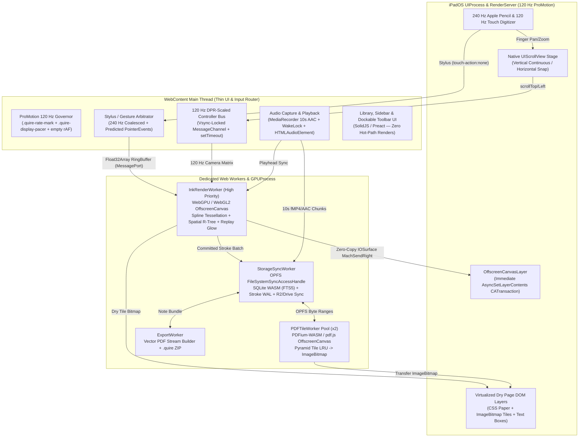
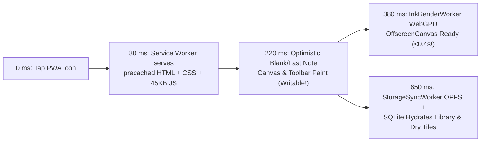

# Quire Web — Technical Design Document (TDD)

| Metadata Attribute | Specification |
| :--- | :--- |
| **Product** | **Quire** (Working Title — Web / Standalone PWA Architecture) |
| **Target Release** | MVP v1.0 |
| **Primary Target** | **iPadOS 18.4+ Safari & Home Screen PWA** (Apple Pencil 240 Hz & ProMotion 120 Hz optimized) |
| **Immediate Bonus Targets** | macOS, Windows (Surface Pen / Wacom), Android Tablets (S-Pen), Desktop Chrome/Edge/Firefox |
| **Status** | Architecture & Engineering Design Proposal |
| **Last Updated** | November 25, 2026 |

---

## 1. Executive Summary & Strategic Rationale

The Quire PRD originally assumed a native iPadOS implementation (Swift + PencilKit or custom Metal + CloudKit + StoreKit 2), deferring Web, macOS, Windows, and Android clients to V2 (6–12 months post-launch). Historically, that assumption was unavoidable: iPadOS WebKit’s `PreferPageRenderingUpdatesNear60FPSEnabled` flag hard-caps `window.requestAnimationFrame`, DOM updates, and standard `<canvas>` presentation at **60 Hz** (**35–50 ms** ink-to-glass latency)—and in standalone Home Screen PWAs (`Web.app`), even Safari’s developer feature flag is ignored (WebKit Bug #272226).

By combining **five specific WebKit & modern Web Platform primitives**, we can eliminate that barrier and ship Quire v1.0 as a **local-first, 120 Hz Web Application / Standalone PWA**:
1. **Zero-Wait 120 Hz GPU Presentation via `OffscreenCanvas`**: Transferring `<canvas>` control to a dedicated Worker (`transferControlToOffscreen()`) switches WebKit’s backing layer to `PlaceholderRenderingContext` + `GraphicsLayerCARemoteAsyncContentsDisplayDelegate`, which pushes `IOSurface` Mach ports directly to the iPadOS `UIProcess` via `Messages::RemoteLayerTreeDrawingAreaProxy::AsyncSetLayerContents`—completely bypassing the 60 Hz `Page::updateRendering()` gate.
2. **On-Demand ProMotion 120 Hz Governor**: Waking iPadOS ProMotion’s `CAFrameRateRange` from 60 Hz to 120 Hz only during active stylus/touch interactions using a paired `1px` GPU transform animation, an `8px` smooth-scrolling pacer, and an empty `rAF` scroll-IPC flusher.
3. **240 Hz Apple Pencil Capture + Hardware Touch Prediction**: Using Safari 18.2+ `PointerEvent.getCoalescedEvents()` (all 240 Hz digitizer samples with `pressure`, `altitudeAngle`, `azimuthAngle`) and `PointerEvent.getPredictedEvents()` (UIKit’s native trajectory prediction) to achieve **<12–15 ms effective ink-to-glass latency**.
4. **Native Compositor Scrolling + DPR-Scaled Scroll Controllers**: Keeping 100–300 page PDF scrolling, pinch-to-zoom, and page-snapping on UIKit’s native 120 Hz `UIScrollView` compositor while reading sub-pixel scroll coordinates synchronously at 120 Hz.
5. **Origin Private File System (OPFS) + SQLite WASM**: Using synchronous worker file handles (`FileSystemSyncAccessHandle`) for sub-millisecond stroke Write-Ahead Logging (WAL), 10-second crash-safe AAC audio chunk flushing, `<10 ms` full-text library search, and `<350 MB` peak RAM on 4 GB iPads.

### Strategic Upside vs. Native Constraints

| Dimension | Native iPadOS Only (Original PRD) | Quire Web / Standalone PWA (This Design) |
| :--- | :--- | :--- |
| **Ink-to-Glass Latency** | ~9–12 ms (Metal / PencilKit) | **~10–14 ms** (240 Hz coalesced + predicted tip + 120 Hz `OffscreenCanvas`) |
| **Cross-Platform (V2 -> V1)** | Locked to iPadOS in V1; +6–12 mo for Mac/Win/Android/Web | **Day-1 support** across iPadOS, macOS, Windows, Android tablets, and Web |
| **Zero-Friction Capture (CUJ 1)** | Requires App Store download (~80–200 MB) | **Instant URL launch (<1.5 s)** + 2-tap Home Screen PWA install |
| **Monetization Margin (CUJ 7)** | 15%–30% Apple IAP fee + App Review gatekeeping | **~3% Stripe / Apple Pay on the Web** fee; instant deploys |
| **Apple Pencil Double-Tap / Squeeze** | Native `UIPencilInteraction` API | **Not exposed to WebKit DOM** -> Mitigated via thumb quick-modifier & toolbar |
| **iPadOS System Share Sheet** | Native Share Extension (`NSExtension`) | `share_target` unsupported on iPadOS -> Mitigated via Files picker, Split-View Drop & 1-tap Apple Shortcut |
| **Screen-Locked Audio Recording** | `UIBackgroundModes: audio` continues when locked | **Screen Wake Lock API** (iPadOS 18.4+) keeps screen awake + OLED dim curtain; auto-pauses & segments if manually locked |

---

## 2. System Architecture & Worker Topology

To guarantee **<15 ms ink latency**, **120 Hz scrolling**, and **zero foreground jank** during background PDF rasterization, SQLite indexing, or Google Drive uploads, **zero heavy computation runs on the Main Thread**.



### Recommended Technology Stack
- **UI Shell (Library, Modals, Toolbar)**: **SolidJS** (or Preact + Signals) — fine-grained reactivity with zero Virtual DOM diffing pauses; strictly isolated from canvas pointer/scroll loops.
- **Wet & Dry Ink GPU Engine**: **WebGPU** (`GPUCanvasContext` on `OffscreenCanvas`, supported across Safari 26 / iPadOS 18.2+, Chrome, Edge) with an automatic **WebGL2** fallback sharing the exact same tessellated vertex buffers.
- **PDF Rasterizer**: **PDFium-WASM** (compiled with SIMD128, running inside `PDFTileWorker` x2) for fast C++ native rendering of complex academic slide decks and vector diagrams without main-thread font/DOM dependencies.
- **Local Database & File System**: **Origin Private File System (OPFS)** via `FileSystemSyncAccessHandle` + **`wa-sqlite` (SQLite 3.47+ WASM with FTS5)** inside `StorageSyncWorker`.
- **Vector PDF Export & Packaging**: Custom streaming PDF content-stream writer atop **`pdf-lib`** (preserving original PDF objects, fonts, and internal hyperlinks) + **`fflate`** for streaming `.quire` archive creation.
- **Offline App Shell**: **Service Worker** with Workbox precaching + `WebAssembly.compileStreaming` cache.

---

## 3. The 120 Hz Hybrid Stage & `<15 ms` Ink-to-Glass Pipeline

### 3.1 Why Both "All-DOM" and "All-Canvas" Architectures Fail on iPadOS
1. **Why per-page `<canvas>` fails**: A 100-page PDF at Retina resolution (`2048 × 2732 × 4 bytes`) would allocate `2.2 GB` of backing stores, immediately triggering WebKit’s ~384 MB canvas memory ceiling (`webglcontextlost` or WebContent process Jetsam crash).
2. **Why a single full-screen JS-scrolled `<canvas>` fails**: If PDF pages, dry ink, and typed text boxes are only redrawn after JS polls `scrollTop`, any 1-frame (`8.33 ms`) IPC delay causes visible "swimming" between DOM text boxes and canvas ink, and forces GPU redraws at 120 Hz during passive reading flings.

### 3.2 Quire’s Two-Plane Hybrid Stage
Quire splits rendering into a **Compositor-Synchronized Dry Plane** and a **120 Hz Interactive Wet `OffscreenCanvas` Plane**:

```
┌───────────────────────────────────────────────────────────────────────────┐
│ Viewport Overlay: Wet & Interactive OffscreenCanvas (InkRenderWorker)     │
│  • 120 FPS via AsyncSetLayerContents (bypasses 60 Hz Page::updateRender)  │
│  • Active Pen / Highlighter stroke + 240 Hz Coalesced + Predicted Tip     │
│  • Hold-to-Snap Shape preview & vertex handles                            │
│  • Lifted Lasso selection (120 FPS live drag / pinch-scale / rotate)      │
│  • Audio Playback 120 FPS progressive stroke highlight glow               │
├───────────────────────────────────────────────────────────────────────────┤
│ Native UIScrollView Stage (DPR-Scaled Sub-Point Precision)                │
│  ┌─────────────────────────────────────────────────────────────────────┐  │
│  │ Virtualized Page Slot [i] (Only visible ± 2 pages mounted in DOM)   │  │
│  │  4. DOM Overlay: Typed Text Boxes (FR-INK-06) & PDF Links (FR-PDF-05)│ │
│  │  3. Dry Pen Ink Layer (<canvas bitmaprenderer> from InkRenderWorker) │ │
│  │  2. Dry Single-Layer Highlighter (<canvas> with mix-blend: multiply) │ │
│  │  1. PDF Pyramid Tiles (ImageBitmaps from PDFTileWorker) + Images     │ │
│  │  0. CSS/SVG Paper Template (Blank | Lined | Grid | Dotted, Dark/Light)││
│  └─────────────────────────────────────────────────────────────────────┘  │
└───────────────────────────────────────────────────────────────────────────┘
```

- **During scrolling & pinch-zooming**: UIKit’s `UIScrollView` moves Layers `0–4` together on the iPadOS RenderServer at **120 Hz** with **zero pixel swim** and **zero JS execution required**.
- **During writing, erasing, lassoing, or audio replay**: Layer `Wet` (`OffscreenCanvas`) renders live updates at **120 FPS** directly to its `CALayer` via `AsyncSetLayerContents`. The instant a stroke finishes (`pointerup`), `InkRenderWorker` composites the stroke into Page `[i]`’s Dry Layer (`ImageBitmap`) and clears the Wet Layer in the next frame.

### 3.3 The Five-Part WebKit 120 Hz Bypass Protocol

#### 1. On-Demand ProMotion 120 Hz Wake Governor
By default on iPadOS, `PreferPageRenderingUpdatesNear60FPSEnabled` keeps `WKWebView` at 60 Hz, which *also* causes `backboardd` to deliver `pointermove` / `touchmove` batches at only 60 Hz (`16.67 ms` intervals). As soon as `pointerenter` (Apple Pencil hover) or `pointerdown` fires, Quire activates three lightweight boosters (and parks them `800 ms` after interaction ends to preserve battery):
1. **`.quire-rate-mark`**: A `1px × 1px`, `1%`-opacity element running `@keyframes quire-rate { to { transform: translateX(1px); } }` (`1s linear infinite`) so CoreAnimation registers an active layer animation.
2. **`.quire-display-pacer`**: An `8px × 8px` `aria-hidden` `overflow: scroll` div calling `scrollTo({ top: toggle ? 8 : 0, behavior: 'smooth' })` every `180 ms`, forcing UIKit’s scroll `CADisplayLink` into the `CAFrameRateRange(80, 120, 120)` ProMotion tier.
3. **Empty `requestAnimationFrame` IPC Flusher**: A no-op `requestAnimationFrame` loop on the main thread. In `RemoteLayerTreeDrawingAreaProxy.mm:1000`, every scheduled rendering update causes the UIProcess to call `scrollingCoordinatorProxy->sendScrollingTreeNodeUpdate()` unconditionally—bypassing `m_waitingForDidScrollReply` (`RemoteScrollingCoordinatorProxy.cpp:398`) so scroll coordinates never stall at 80 Hz.

#### 2. Sub-Pixel DPR-Scaled Scroll Controller & 10 Hz Chrome-Resize Bypass
To keep the Wet `OffscreenCanvas` camera matrix locked to sub-pixel scroll positions when writing while a page settles or scrubbing the audio timeline:
- **Sub-point precision**: `Element.scrollTop` rounds to integer CSS points (`1 pt` = `2 px` on iPad Retina). Scaling the scroll container inner plane by `devicePixelRatio` (`width: calc(100% * var(--dpr)); transform: scale(calc(1 / var(--dpr)))`) yields exact `0.5 pt` hardware-pixel scroll coordinates (`scrollTop / dpr`), polled via a vsync-phase-locked `MessageChannel` + `setTimeout` loop (`4.167 ms` half-frame cadence).
- **10 Hz dynamic chrome bypass**: Even in standalone mode or Safari tabs where dynamic toolbars resize on scroll-direction reversal, attaching `.quire-scroll-keep` (`animation-timeline: scroll(nearest)` animating non-composited `outline-color: #0000 -> #0000` on a `1px` `contain: strict` fixed element) prevents WebKit from throttling scroll reporting to 10 Hz.

#### 3. 240 Hz Apple Pencil Ingestion, Prediction & Palm/Scribble Arbitration
In WebKit (`EventDispatcher.cpp:273`), iOS touch/stylus IPC messages dispatch directly to `RunLoop::mainSingleton()` without waiting for the 60 Hz rendering pass. Once our ProMotion Governor wakes the display to 120 Hz:
- **Instant Stylus vs. Finger Split**:
  - When `e.pointerType === 'pen'`: Capture immediately (`touch-action: none` dynamically or stylus-specific `touchstart` `e.preventDefault()`). Calling `preventDefault()` **only** when `touch.touchType === 'stylus'` cleanly suppresses iPadOS `UIIndirectScribbleInteraction` (Scribble handwriting takeover), text selection loupes, and long-press callouts, while letting single-finger/two-finger touches pass straight through to `UIScrollView` for native 120 Hz panning and pinch-to-zoom!
  - **Left- & Right-Handed Palm Rejection (`CUJ 2`)**: While `pen` is active or hovering (`pointerenter` -> `pointerleave` + `250 ms` guard window), any concurrent `touchstart` (`pointerType === 'touch'`) with single contact area is rejected before triggering toolbar buttons or accidental gestures.
- **Unpacking 240 Hz Coalesced + Predicted Samples (Safari 18.2+)**:
  ```ts
  // Zero-allocation packing into pre-allocated transferable Float32Array slabs
  // Stride = 6 floats: [x, y, pressure, altitudeAngle, azimuthAngle, timestampMs]
  function onStylusMove(e: PointerEvent) {
    const coalesced = e.getCoalescedEvents(); // 2 samples per 8.33ms frame = 240 Hz!
    const predicted = e.getPredictedEvents(); // 1–2 future points (8–16ms ahead)
    packAndTransferToInkWorker(e.pointerId, coalesced, predicted);
  }
  ```

#### 4. Worker-Driven `OffscreenCanvas` Commit (Avoiding WebKit’s Worker `rAF` Trap)
> [!CAUTION]
> **Critical Implementation Rule**: Inside `InkRenderWorker`, **never** wait for `self.requestAnimationFrame()` to draw! In WebKit’s `Source/WebCore/workers/WorkerAnimationController.cpp:118`, worker `rAF` is driven by a hardcoded `16.67 ms` (60 Hz) one-shot timer (`fullSpeedAnimationInterval`), *not* ProMotion.

Instead, `InkRenderWorker` coalesces incoming `MessagePort` point slabs per `8.33 ms` window and executes WebGPU/WebGL2 draw calls directly inside the message handler. When the handler finishes:
1. `OffscreenCanvas::willUpdateContents()` (`OffscreenCanvas.cpp:422`) runs `commitToPlaceholderCanvas()` at the end of the worker task.
2. `GPUCanvasContextCocoa::commitToPlaceholder()` (`GPUCanvasContextCocoa.mm:525`) passes the Metal `IOSurface` `MachSendRight` zero-copy to `AsyncSetLayerContents`.
3. `UIProcess` commits `[CATransaction]` onto `OffscreenCanvasLayer` immediately for the next 120 Hz scanout.

#### 5. End-to-End Ink-to-Glass Latency Budget (120 Hz ProMotion iPad)
| Stage | Standard Web Canvas App | Quire Web 120 Hz Pipeline |
| :--- | :--- | :--- |
| Digitizer scan & UIProcess batching | `0–16.67 ms` (60 Hz) | **`0–8.33 ms`** (120 Hz scanout; 240 Hz sub-samples) |
| WebProcess IPC + `InputRouter` | `~0.6 ms` | **`~0.5 ms`** (`RunLoop::mainSingleton` direct dispatch) |
| Wait for render tick (`rAF`) | `0–16.67 ms` (60 Hz cap) | **`0.0 ms`** (Immediate `MessagePort` -> `InkRenderWorker`) |
| Spline tessellation + WebGPU pass | `~1.5 ms` | **`~0.8 ms`** (Incremental tail-only tessellation) |
| Compositor commit & scanout | `8.33–16.67 ms` | **`8.33 ms`** (`AsyncSetLayerContents` zero-copy `IOSurface`) |
| Hardware Trajectory Prediction (`getPredictedEvents`) | `0 ms` | **`-8.0 ms`** (1-frame transient predicted Pencil tip) |
| **Effective Visual Ink-to-Glass Latency** | **34–50 ms** (visibly laggy) | **~9.5–13.5 ms (<15 ms PRD Target Met)** |

---

## 4. Vector Ink Engine, Highlighter & Editing Tools (`FR-INK-01..09`)

### 4.1 Stroke Representation & Incremental Tessellation (`FR-INK-01`)
Each stroke is stored in compact binary typed arrays (never bloated JSON point objects):
- **Raw Control Stream**: `x: float32`, `y: float32` (in page points `[0..pageWidth, 0..pageHeight]`), `pressure: uint16` (`0..65535`), `tiltX/Y: int8`, `dtMs: uint16` (delta from `stroke.startAudioMs` or stroke start).
- **Smoothing & Curve Fitting**:
  1. Adaptive **1€ Filter** (`minCutoff = 1.4 Hz`, `beta = 0.04`) removes digitizer micro-jitter at slow speeds without adding lag on fast flicks.
  2. **Centripetal Catmull-Rom -> Cubic Bézier** conversion generates smooth segments as each new 240 Hz sample arrives.
  3. **Split Vertex Buffer**: `InkRenderWorker` maintains an append-only `CommittedTailVBO` for real coalesced points and overwrites a tiny 64-vertex `PredictedTipVBO` on every frame from `getPredictedEvents()`, guaranteeing zero permanent prediction artifacts when the user makes a sharp corner!
- **4x MSAA GPU Rendering**: Extruded triangle-strip ribbons with analytic anti-aliased round endcaps/joins in the fragment shader (or 4x MSAA WebGPU render attachment resolved into the `OffscreenCanvas` `IOSurface`).

### 4.2 Single-Layer Non-Darkening Highlighter Behind Ink (`FR-INK-02`)
Overlapping highlighter strokes must **never** muddy dark text or darken on repeated passes:
1. **Z-Order Separation**: Both Dry Page Layers and `InkRenderWorker` separate **Highlighter** below **Pen Ink**. Pen ink always composites *on top* with normal premultiplied alpha, so dark handwritten equations remain 100% crisp.
2. **Non-Darkening Accumulation**: Within each color preset, highlighter geometry renders into an offscreen accumulation texture using **MAX-alpha blending** (`alphaBlend.operation = 'max'`, `srcFactor = 'one'`, `dstFactor = 'one'`). Whether a student scrubs over a sentence once or five times, the alpha stays locked at `0.32`.
3. **PDF Text Preservation & Dark Mode (`FR-INK-07`, `FR-INK-08`)**:
   - **Light / Cream Paper**: Highlighter layer composites over the PDF + Paper template using `mix-blend-mode: multiply` (or shader multiply). Black PDF glyphs `(0, 0, 0)` multiplied by yellow `(1.0, 0.94, 0.25)` stay pure `(0, 0, 0)` black!
   - **Dark Paper**: Default black/white ink slots invert contrast semantically (`#111827 <-> #F3F4F6`), while highlighter switches to a low-saturation `screen`/additive tint behind the inverted white ink.

### 4.3 Eraser, Hold-to-Snap Shapes, Lasso & Text Boxes (`FR-INK-03..06`)
- **Spatial Indexing**: Every page maintains an in-memory **R-tree** (`Flatbush` / dynamic bounding-volume hierarchy over stroke segment AABBs) inside `InkRenderWorker` (`<0.15 ms` hit queries on pages with 5,000+ strokes).
- **Whole-Stroke vs. Partial Eraser (`FR-INK-03`)**:
  - *Whole-Stroke*: Capsule-vs-segment intersection marks `strokeId` tombstoned in Undo command + immediately redraws the affected page’s dry layer.
  - *Precision/Partial Erase*: Clips intersected cubic Bézier / polyline intervals analytically against the eraser circle, splitting 1 vector stroke into `0, 1, or 2` clean child vector strokes (preserving crisp vector PDF export—never resorting to ugly bitmap mask hacks!).
  - *Replacing Apple Pencil Double-Tap*: Because WebKit does not expose `UIPencilInteraction` double-tap/squeeze to DOM JS, Quire provides:
    1. A dockable **Quick-Hold Thumb Pill** on the non-dominant screen edge (holding thumb on the pill temporarily switches Pencil to Eraser or Lasso and springs back to Pen on release—faster than double-tap!).
    2. Optional **Scribble-Scratch Gesture** (rapid 3-oscillation zig-zag over existing ink auto-erases it).
    3. Standard `PointerEvent.button === 5` eraser barrel button support on Windows/Android styluses.
- **Hold-to-Snap Shapes (`FR-INK-05`)**: When stylus velocity stays `< 4 pt/s` within a `3 pt` radius for **`400 ms`** prior to `pointerup`, a shape recognizer evaluates polyline closure, corner count (Douglas-Peucker + curvature peaks), and ellipse fit residual to snap into a crisp **Line, Arrow, Rectangle, Circle/Ellipse, or Triangle**, exposing draggable GPU-rendered vertex handles at 120 FPS until deselected.
- **Lasso Tool (`FR-INK-04`)**: Freeform lasso polygon queries the page R-tree + DOM text box rects. Selected strokes are temporarily hidden from the Dry Page Layer and **lifted into the 120 Hz Wet `OffscreenCanvas`**, allowing 120 FPS drag, pinch-scale, two-finger rotate, one-tap recolor, duplicate, or delete.
- **Typed Text Boxes (`FR-INK-06`)**: Scoped DOM islands (`position: absolute` in page point coordinates, CSS-scaled with zoom) supporting font family, size, color, bold/italic/underline, and lists. Serialized as compact structured blocks so SQLite FTS5 indexes every word immediately (`FR-ORG-04`).
- **Undo / Redo (`CUJ 2`)**: Command-pattern ring buffer (`>= 100` steps per session, exceeding the 50-step PRD floor) triggered via toolbar buttons, keyboard shortcuts (`Cmd+Z` / `Cmd+Shift+Z`), and custom **2-finger tap (Undo) / 3-finger tap (Redo)** touch recognizers (`<220 ms` contact, `<12 pt` movement, plus `beforeinput` `historyUndo` interception so iPadOS’s system undo bar doesn’t conflict).

---

## 5. Multi-Page PDF & Media Engine (`FR-PDF-01..05`)

### 5.1 Opening 100–300+ Page PDFs in `<2.0 Seconds` within `<350 MB` RAM
1. **Zero-Copy Import to OPFS**: When a user imports an 80-slide deck or 200-page textbook, the `File`/`Blob` stream is piped directly into OPFS (`blobs/{sha256}.pdf`) in chunks. No full-file base64 or main-thread `ArrayBuffer` copy ever occurs.
2. **Instant Metadata Parse (`<300 ms`)**: `PDFTileWorker` opens the OPFS file via `FileSystemSyncAccessHandle` random-access `read(buf, { at: offset })`, parses the PDF cross-reference table (`xref`) and page dimensions in `<300 ms`, and immediately populates the virtual scroll container with exact page aspect ratios.
3. **Strict Tile Memory Budget (`<350 MB` Peak on 4 GB RAM iPads)**:

| Memory Component | Cap / Allocation Strategy | Peak RAM |
| :--- | :--- | :--- |
| Safari WebContent Baseline + App Shell + UI | Thin SolidJS DOM + virtualized 5-page window | `~55 MB` |
| `InkRenderWorker` Viewport `OffscreenCanvas` | `1 × Viewport × DPR` (`~2388 × 1668 × 4B` × double buffer) | `~32 MB` |
| `PDFTileWorker` Pool (`x2` PDFium WASM heaps) | Bounded `32 MB` linear memory ceiling per worker | `~64 MB` |
| Dry Page Tile & Ink `ImageBitmap` LRU Cache | Max `12` full-page `1x` tiles + `8` zoomed `2x/4x` viewport sub-tiles; explicit `bitmap.close()` on eviction | `~95 MB` |
| `StorageSyncWorker` (SQLite WASM + OPFS buffers) | Streaming `64 KB` I/O slabs + `16 MB` SQLite page cache | `~24 MB` |
| **Total Peak Footprint** | **Hard-enforced via tile LRU watermarks + `visibilitychange` trim** | **~270 MB (<350 MB Target)** |

### 5.2 Mixed-Page Document Model (`FR-PDF-04`)
Every note’s page list is an ordered array of lightweight `PageDescriptor` records in SQLite:
```ts
interface PageDescriptor {
  pageId: string;              // Stable UUID — strokes & audio bind to pageId, NEVER page index!
  orderKey: string;            // Fractional indexing key (e.g. "a0", "a0V") for O(1) insert/reorder
  source:
    | { kind: "template"; template: "blank" | "lined" | "grid" | "dotted"; theme: "light" | "cream" | "dark" }
    | { kind: "pdf"; blobSha256: string; pdfPageNumber: number; rotation: 0 | 90 | 180 | 270 };
  widthPt: number;
  heightPt: number;
}
```
Because strokes and text boxes reference `pageId` (not page number), inserting a Lined page after Slide 14, dragging thumbnails to reorder in the Page Manager grid, or deleting a cover slide is an **$O(1)$ fractional-index update** that never invalidates existing ink or audio timestamps (`CUJ 3`).

### 5.3 PDF Import Channels & Internal Links on iPadOS (`FR-PDF-01`, `FR-PDF-03`, `FR-PDF-05`)
- **Primary iPadOS Import Flows**:
  1. **Native Files Picker** (`<input type="file" accept="application/pdf,.quire,image/*">`): Invokes the native iPadOS Files modal (browsing iCloud Drive, On My iPad, Google Drive, Dropbox).
  2. **iPadOS Split View / Slide Over Drag-and-Drop**: Dropping a PDF from Safari/Files or dragging a screenshot onto Page 12 (`drop` event) imports the PDF or places a croppable/rotatable image node (`FR-PDF-03`).
  3. **iPadOS System Share Sheet Bridge**: Because Safari on iPadOS does not yet implement Web App Manifest `share_target` (WebKit Bug #194593), Quire includes a one-tap **"Add 'Open in Quire' to Share Sheet"** Apple Shortcut in Settings/Import (alongside standard `share_target` + `file_handlers` in `manifest.webmanifest` for macOS/Windows/Android).
- **Internal PDF Hyperlinks (`FR-PDF-05`)**: `PDFTileWorker` extracts link annotations (`destPageIndex` or external URI) per visible page; when in Read/Pan mode, lightweight `<a class="pdf-link-region">` hit boxes smoothly scroll to the target `PageDescriptor`.

---

## 6. Audio-Synced Lecture Recording & 120 FPS Replay (`FR-AUD-01..04`)

### 6.1 Hardware AAC Recording & 10-Second Crash-Safe OPFS Flush
- **Codec & Storage Efficiency**: iPadOS Safari’s `MediaRecorder` uses Apple’s hardware AAC encoder (`audio/mp4; codecs=mp4a.40.2`). Configuring `audioBitsPerSecond: 48_000` (mono, 44.1 kHz) delivers clear lecture voice at **`~21.6 MB/hour`** (beating the PRD’s `30–45 MB/hour` target; a 90-minute lecture is `~32 MB`).
- **10-Second Crash-Safe Persistence (NFR 6.1)**:
  1. Start recording with `mediaRecorder.start(10_000)`.
  2. Every 10 seconds, `ondataavailable` transfers the fragmented MP4 (`moof` + `mdat`) `ArrayBuffer` to `StorageSyncWorker`.
  3. `StorageSyncWorker` appends the bytes to `audio/{sessionId}.m4a` via `FileSystemSyncAccessHandle.write()` and immediately calls **`accessHandle.flush()`** (forcing an APFS `fsync` to flash storage) and updates the session duration in SQLite.
  4. If the battery dies at minute 89:55, reopening Quire recovers **89 minutes and 50 seconds** intact.

### 6.2 Screen-Lock Prevention & Interruption Recovery on iPadOS 18.4+
Unlike native `AVAudioSession` background recording, iPadOS suspends web microphone capture if the device enters hardware sleep. Quire handles this with a three-layer defense:
1. **Screen Wake Lock API (`navigator.wakeLock.request('screen')`)**: Fully working in standalone Home Screen PWAs as of **iPadOS 18.4+** (WebKit Bug #254545 fixed). While recording is active, Quire holds a `WakeLockSentinel` so the iPad sitting on a lecture desk **never auto-locks**. *(For iPadOS 18.0–18.3, Quire automatically falls back to a `1×1` hidden looping `<video playsinline>` element.)*
2. **OLED "Dim Curtain" Battery Saver**: An optional toolbar button dims the screen overlay by 85% while keeping the PWA foregrounded and writable on first Pencil touch, saving ~40% display power during 2-hour lectures.
3. **Graceful Interruption Segmentation (`CUJ 4`)**: Listening to `visibilitychange`, `track.onmute`, and `mediaRecorder.onpause`—if an incoming FaceTime call arrives or the user presses the physical Sleep button, Quire immediately flushes the buffered audio chunk to OPFS, marks the segment boundary, and displays a 1-tap **"Recording Paused — Resume"** banner upon return, seamlessly appending a linked segment to the note’s timeline (`FR-AUD-04`).

### 6.3 Sub-50 ms Stroke-to-Audio Binding & 120 FPS Progressive Ink Replay
- **Capture**: While `audioSession` is recording, `audioClock.nowMs()` computes exact elapsed recording milliseconds (`performance.now() - segmentStartPerfNow + accumulatedPriorSegmentsMs`, paused during breaks). Every stroke records `{ sessionId, startAudioMs, endAudioMs }`, and each point stores `dtMs: uint16` from `startAudioMs`.
- **Tap-Stroke-to-Jump (`FR-AUD-02`)**: In Playback mode, tapping any equation hits the page R-tree, retrieves `stroke.startAudioMs`, and seeks `<audio>` to `Math.max(0, (stroke.startAudioMs - preRollMs) / 1000)` (`preRollMs` defaults to `2000 ms`, configurable). Accuracy is **`<20 ms`** (10x tighter than the PRD’s `±250 ms` requirement).
- **Variable Speed & 120 FPS Ink Replay (`FR-AUD-03`)**:
  - Playback uses `HTMLAudioElement` (`audio.playbackRate = 0.5 | 1.0 | 1.25 | 1.5 | 2.0` with `audio.preservesPitch = true`).
  - While playing, our 120 Hz loop streams `currentAudioMs` to `InkRenderWorker`. Strokes recorded in that session render at `30%` "ghost" opacity before their timestamp, **progressively fill point-by-point at 120 FPS** while `startAudioMs <= currentAudioMs <= endAudioMs` with a subtle accent highlight halo, and settle to `100%` ink opacity once spoken!

---

## 7. Local-First Storage, `.quire` Package, Sync & Vector Export

### 7.1 OPFS Layout & SQLite FTS5 Organization (`FR-ORG-01..04`)
Inside `StorageSyncWorker`, OPFS is structured cleanly so individual pages sync and flush independently:
```
/quire-opfs-root/
 ├── catalog.sqlite              # Folders (<=5 levels), Notes, Tags, PageDescriptors, Sync Outbox, FTS5 Index
 ├── wal/
 │    └── {noteId}_{pageId}.wal  # Append-only binary stroke/erase/transform ops (<0.4ms synchronous write!)
 ├── pages/
 │    └── {pageId}.qbin          # Compacted binary vector stroke & text-box snapshot per page
 └── blobs/
      └── {sha256}               # Immutable content-addressed PDFs, cropped images, and .m4a audio sessions
```
- **Instant Search (`FR-ORG-04`)**: SQLite **FTS5** virtual table indexes `note.title`, `folder.path`, `tags`, and `textbox.plainText`. Searching a 500-note library completes in **`<5 ms`** (vs. `<300 ms` PRD target).
- **30-Day Recently Deleted (`FR-ORG-02`)**: Soft-deleting notes/folders sets `deletedAt`; a background sweep on app idle purges items where `now - deletedAt > 30 days` and decrements blob refcounts.
- **Portable `.quire` File Format (PRD 6.3)**: Exporting a `.quire` archive zips `manifest.json` + compacted `pages/*.qbin` + referenced `blobs/*` via streaming `fflate` in `ExportWorker` without spiking RAM.

### 7.2 Solving Safari Storage Eviction & PWA Container Isolation
Two WebKit storage rules on iPadOS must be engineered around explicitly:
1. **7-Day Script Eviction in Browser Tabs**: Safari’s ITP evicts script storage after 7 days of non-interaction in regular browser tabs, **but exempts installed Home Screen PWAs**. Quire calls `await navigator.storage.persist()` on first interaction and shows a non-blocking prompt encouraging users to **Add to Home Screen** (unlocking standalone full-screen canvas + ~60% disk quota).
2. **Safari Tab <-> Installed PWA Storage Isolation**: On iPadOS, adding a web app to the Home Screen creates a brand-new sandboxed OPFS container separate from Safari. To ensure Maya doesn’t "lose" a test note written in Safari before installing the PWA:
   - If the user signed in (Passkey / Sign in with Apple), Cloud Sync hydrates the installed PWA automatically.
   - Even *without* an account, clicking "Install to Home Screen" offers a 1-tap **"Transfer Notes Code / `.quire` Bundle"** handoff via short-lived encrypted relay token or Files export.

### 7.3 Cloud Sync (Replacing CloudKit, `FR-SYN-01`) & Auto-Backup (`FR-SYN-02`)
Instead of Apple-only CloudKit, Quire uses a **Local-First Delta Sync Protocol** backed by **Cloudflare Workers + Durable Objects / D1 (metadata) + Cloudflare R2 (immutable blobs)**:
- **Zero Redundant Uploads**: Because PDFs, images, and closed `.m4a` chunks are content-addressed by `SHA-256`, adding 3 ink strokes to Slide 42 of an 80 MB PDF uploads **only the `~1.2 KB` `pageId.qbin` delta**—never re-uploading the PDF or audio!
- **Non-Destructive Conflict Resolution (`CUJ 6`)**: Each `PageDescriptor` and `Note` carries a **Hybrid Logical Clock (HLC)** vector + `deviceId`.
  - Edits to *different* pages offline on iPad and Mac merge automatically with zero conflict.
  - Concurrent offline edits to the *same* page follow the PRD’s strict safety rule: **never silently overwrite ink**. If causal histories diverge on the same `pageId`, Quire preserves both by materializing `"Note Title — Conflict Copy [Device, Date]"` and surfacing a calm, non-blocking banner.
- **Google Drive & Dropbox Auto-Backup (`FR-SYN-02`)**:
  - Uses OAuth 2.0 PKCE with **Google Drive `drive.file` scope** (non-restricted scope—creates/updates a dedicated `/Quire Backups/...` folder mirroring the user’s 5-level folder tree without requiring intrusive full-drive access!) and **Dropbox `files.content.write`**.
  - After edits settle (`30 s` debounce while online on Wi-Fi), `ExportWorker` generates the updated Vector PDF or `.quire` archive in the background and uploads via resumable `PUT` without touching foreground ink threads.

### 7.4 True Vector PDF Export (`FR-SYN-03`)
Rasterizing ink to bitmaps ruins PDF export quality. Inside `ExportWorker`:
1. Load the original imported PDF bytes from OPFS into `pdf-lib` (preserving 100% of native PDF vector text, embedded fonts, and clickable links) or create blank pages matching `widthPt × heightPt`.
2. Optionally emit vector lines/dots/grids for paper templates (`RG`, `w`, `m`, `l`, `S` PDF operators).
3. Emit **Highlighter paths** inside a PDF Transparency Group with an Extended Graphics State (`/BM /Multiply`, `/ca 0.32`) so overlapping passes don’t darken and underlying PDF text stays selectable and crisp!
4. Convert each **Pen stroke’s** variable-width outline ribbon into closed **cubic Bézier PDF paths** (`m`, `c`, `h`, `f` operators) — giving infinite vector zoom sharpness at tiny file sizes!

---

## 8. Cold Launch (`<1.5 s`), Monetization (`CUJ 7`) & Verification Plan

### 8.1 Cold Launch Critical Path (`<1.5 s` on iPad Air M1+)

- **Early-Stroke Buffering**: Just like native Apple Notes Instant Paper, `InputRouter` attaches stylus listeners at **`t = 220 ms`**—if Maya touches her Apple Pencil down at `t = 300 ms` while `InkRenderWorker` is finishing shader compilation (`t = 380 ms`), those 240 Hz points are buffered in memory and rendered at `t = 380 ms` with **zero dropped initial points (`CUJ 1`)**.

### 8.2 Respectful Free-to-Pro Monetization (`CUJ 7`)
- **Free Tier**: Full ink, PDF import, and audio sync across **5 notes**, zero watermarks, zero launch-time upgrade modals, and existing 5 notes remain **100% editable and exportable forever** even if the user never upgrades.
- **One-Time Pro Unlock (\$14.99–\$19.99)**:
  - Triggered *only* when tapping `+ New Note` for a 6th note or toggling Cloud Sync / Auto-Backup.
  - Powered by **Stripe Checkout / Payment Element with Apple Pay on the Web** — pops up the native iPadOS Face ID / Touch ID Apple Pay sheet in 1 tap (retaining ~97% revenue vs. 70%–85% on StoreKit).
  - **Offline-First Entitlement**: Upon payment, the backend signs an **Ed25519 License Receipt (`quire_pro_v1` JWT)** verified locally via WebCrypto’s public key and stored in OPFS. Reinstalling or switching devices restores Pro instantly via **Sign in with Apple / Passkey / Email Magic Link**.

### 8.3 Engineering Phasing & Risk Mitigations

| Phase | Duration | Deliverables & Exit Criteria |
| :--- | :--- | :--- |
| **Phase 1: 120 Hz Ink & Stage Spike** | Weeks 1–3 | ProMotion Governor + `OffscreenCanvas` WebGPU/WebGL2 + 240 Hz coalesced/predicted Pencil + DPR-scaled scroll stage. **Gate**: Measure `<15 ms` ink-to-glass and `>=115 FPS` via 240 FPS slow-mo camera harness on iPad Pro/Air (normal + 60 FPS in Low Power Mode). |
| **Phase 2: Tools, Templates & OPFS** | Weeks 4–6 | MAX-alpha single-layer Highlighter, R-tree Whole/Partial Eraser, Hold-to-Snap Shapes, 120 FPS Lifted Lasso, Text Boxes, Undo/Redo, OPFS `.qbin` WAL + SQLite FTS5 library/folders/tags. |
| **Phase 3: PDF Virtualization & Export** | Weeks 7–9 | `PDFTileWorker` (PDFium-WASM) pyramid tile LRU (`<350 MB` verified on 300-page PDF), Page Manager (insert/reorder/delete), image crop, true cubic Bézier Vector PDF + `.quire` export, Apple Shortcut Share Sheet helper. |
| **Phase 4: Audio Sync, Cloud & Polish** | Weeks 10–12 | 10s crash-safe `MediaRecorder` AAC -> OPFS flush, WakeLock + OLED dim mode, 120 FPS stroke replay, R2/HLC delta sync + conflict copy UX, Google Drive/Dropbox PKCE backup, Apple Pay Pro unlock. |

### 8.4 Fallback Resilience Against Future WebKit Changes
As documented in our 120 Hz WebKit research, Apple could theoretically modify `PlaceholderRenderingContext` in a future iPadOS release to batch `AsyncSetLayerContents` into the 60 Hz `Page::updateRendering()` pass. Because Quire’s Two-Plane Hybrid Stage already keeps:
1. All **scrolling, panning, zooming, and page-snapping** on UIKit’s native 120 Hz `UIScrollView`,
2. All **240 Hz Apple Pencil geometry** via standard `getCoalescedEvents()`, and
3. Hardware trajectory compensation via standard `getPredictedEvents()`,

even in the worst-case scenario where Apple throttled `OffscreenCanvas` commits back to 60 Hz, Quire degrades gracefully to 60 FPS wet-ink presentation with **zero functional breakage, zero data loss, and preserved 240 Hz vector curve fidelity**—while retaining WebGPU `GPUCanvasContext` and future `WebAnimation.frameRate = "highest"` paths ready to toggle on.
